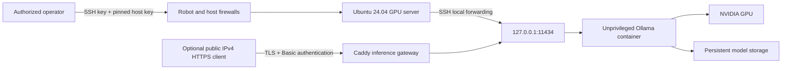

# GPU LLM on Hetzner

Ansible configures an Ubuntu inference server and runs a local Ollama API in
Docker. NVIDIA GPU mode is the default; an explicitly selected CPU demo mode
supports an ordinary Hetzner Cloud VM. The dedicated-server Terraform directory
manages an existing GPU server's Robot network firewall.
GitHub Actions validates the code; a separate manual workflow can run Ansible
from a protected management runner. Optional Caddy HTTPS exposes inference at
the server's public IPv4 address with password authentication; no DNS is needed.

**Validation boundary:** static checks cover the automation and gateway behavior.
The deployment playbook separately verifies real inference on the selected host.
CPU demo mode does not demonstrate NVIDIA driver installation or GPU inference;
the default GPU deployment retains those hardware acceptance checks.

## Architecture and security boundary



- The API is **private by default**. Ollama has no built-in API authentication;
  the playbook refuses a public bind address. Use an SSH tunnel for encrypted,
  authenticated access. Optional public mode opens only TCP 80/443 for a Caddy
  gateway; port 11434 remains private in both modes.
- The container is non-root, has a read-only root filesystem, drops Linux
  capabilities, prohibits new privileges, and has memory/CPU/process/log limits.
- Model data persists in `/var/lib/ollama`; deployment files are root-managed in
  `/opt/ollama`. Cloud features are disabled with `OLLAMA_NO_CLOUD=1`.
- SSH password and keyboard-interactive authentication are disabled; existing
  SSH keys and host-key checking remain required. SSH forwarding stays enabled.
- Docker is root-equivalent administration. No user is added to its group.
  Docker Engine 28+ is required because older releases had a localhost-published
  port exposure issue on the same L2 network. UFW alone is not the security
  boundary for Docker-published ports.
- This assumes a dedicated, clean inference host. Existing unrelated UFW rules
  are retained; review and remove any pre-existing broad ingress rules before
  treating the host as SSH-only. Never reuse this configuration blindly on a
  multi-purpose production server.

## Prerequisites

**GPU target:** Ubuntu 24.04 LTS, x86_64, systemd, a physical/passed-through compatible
NVIDIA GPU, SSH key access, and root or passwordless sudo. Budget at least 16 GB
system RAM and 30 GB free disk for the example; a GPU with 8 GB+ VRAM is a
practical starting point for this small quantized model and 4096-token context.
Actual capacity depends on model, context, and concurrency. A Hetzner GEX45
(24 GB GPU VRAM) comfortably exceeds these example requirements.

For the explicitly selected CPU demo, Ubuntu 24.04 on x86_64 or aarch64 is
supported. A normal Hetzner Cloud VM with 4 vCPUs and 8 GB RAM, such as the ARM
CAX21, can run the same small model without NVIDIA hardware or drivers.
This exercises deployment and the API, but does not satisfy or validate the
original assignment's GPU requirement. CPU generation is slower; measure actual
latency before increasing context length or sharing the endpoint.

**Controller:** Python 3.12+, OpenSSH, and Terraform 1.15.x for the Terraform
directory. The target's Python is supplied by Ubuntu. Internet egress is needed
for Ubuntu, Docker, NVIDIA, Docker Hub, and the Ollama model registry.

Hetzner's GEX GPU machines are **dedicated Robot servers**, not GPU-capable
`hcloud_server` instances. Order/provision the machine, install Ubuntu, and
enroll your SSH key separately. This repository intentionally targets an
existing GEX server and does not automate a hardware purchase.

Verify the server's SSH host-key fingerprint through a trusted channel such as
the provider console before adding it to `known_hosts`. Do not disable host-key
verification or trust an unauthenticated `ssh-keyscan` result by itself.

## Configure and deploy with Ansible

Create a controller environment and a private local inventory:

```bash
python3 -m venv .venv
. .venv/bin/activate
python -m pip install -r requirements-dev.txt
cp inventory/example.yml inventory/local.yml
chmod 600 inventory/local.yml
```

Edit `inventory/local.yml`:

- Replace the documentation IP with your server address.
- Set the existing SSH account and port. Use `ssh-agent` or your local SSH
  configuration for the private-key reference; never put keys/passwords here.
- Replace `server_security_admin_cidrs` with your controller's public IPv4
  egress address or approved VPN range. The host role checks the current SSH
  source, when available, to reduce lockout risk. Robot must allow the same
  source; when using a jump host, this is the jump host's egress address.

Run syntax validation first. For a fresh driver install, explicitly allow the
maintenance reboot:

```bash
ansible-playbook -i inventory/local.yml playbooks/deploy.yml --syntax-check
ansible-playbook -i inventory/local.yml playbooks/deploy.yml \
  --extra-vars gpu_host_allow_reboot=true
```

Subsequent runs can omit the reboot opt-in when no driver update is needed:

```bash
ansible-playbook -i inventory/local.yml playbooks/deploy.yml
```

In its default NVIDIA mode, the playbook rejects CPU-only hosts, installs or verifies the NVIDIA driver,
installs Docker and NVIDIA Container Toolkit, configures the runtime, applies
host security, starts Ollama, installs the model, and verifies actual inference
with nonzero reported GPU residency. An existing working driver at or above
the configured baseline is preserved. A missing/old driver with Secure Boot
enabled fails safely; prepare properly signed modules/MOK enrollment through
your approved procedure rather than disabling Secure Boot automatically.

Model download can take several minutes. Repeated runs do not re-download an
installed model or recreate an unchanged service. A complete `--check` run on a
pristine GPU host cannot simulate package installation, reboots, or CUDA; use
the explicit syntax/lint checks and the post-deployment acceptance checks.

## Explicit CPU demo on Hetzner Cloud

Set these variables in the private inventory for a normal CPU VM; the existing
`gpu_servers` inventory group name is retained for compatibility:

```yaml
inference_accelerator: cpu
ollama_memory_limit: 6g
ollama_cpu_limit: "4"
ollama_context_length: 2048
ollama_parallel_requests: 1
```

These limits suit the 4-vCPU/8-GB CAX21 ARM demo and leave memory for the host.
An 8-vCPU/16-GB x86 VM can use `ollama_cpu_limit: "8"` and
`ollama_memory_limit: 12g`. Keep the context and concurrency modest while
measuring latency; shared CPU availability changes throughput.

Omitting `inference_accelerator` still requires NVIDIA. CPU mode deliberately
skips GPU drivers/toolkit installation, removes GPU device reservations from
Compose, disables GPU visibility, and checks actual CPU inference with zero
reported VRAM residency. The same pinned `qwen3:4b-q4_K_M` model, authentication,
startup, health/recovery and firewall protections remain in use. The watchdog
does not run `nvidia-smi` in this mode. No GPU-host error silently switches the
deployment into CPU mode.

Run the same playbook without a driver reboot opt-in:

```bash
ansible-playbook -i inventory/local.yml playbooks/deploy.yml
```

For public testing, also configure the IP HTTPS options below. A Cloud server
uses the Hetzner Cloud firewall; dedicated GEX machines use Robot instead.

## Example API request

In one terminal, keep an SSH tunnel open (replace the example hostname):

```bash
ssh -N -o ExitOnForwardFailure=yes -o StrictHostKeyChecking=yes \
  -L 127.0.0.1:11434:127.0.0.1:11434 root@gpu.example.org
```

In another terminal:

```bash
curl --fail --silent --show-error http://127.0.0.1:11434/api/chat \
  --header 'Content-Type: application/json' \
  --data '{
    "model": "qwen3:4b-q4_K_M",
    "messages": [{"role": "user", "content": "Explain GPU inference in two sentences."}],
    "stream": false,
    "think": false,
    "options": {"num_ctx": 4096, "num_predict": 128}
  }'
```

The response contains `message.content` and `done`. This request carries no API
key because SSH already authenticates and encrypts the connection. Other local
users on the GPU host can also reach localhost: use a dedicated trusted host.

## Optional public HTTPS access without DNS

Set `public_api_enabled: true` and `public_api_address` to the server's public
IPv4 address in the private inventory. Enable the same flag in Terraform when
using its Robot firewall; public mode permits one SSH administrator CIDR to fit
Robot's ten-rule limit. No domain, DNS record, CDN or DNS API token is required.
Caddy 2.11.7 requests an IP certificate from Let's Encrypt using its `shortlived`
ACME profile and renews it automatically. TCP 80 and 443 must remain reachable
for certificate validation and renewal. This uses publicly trusted TLS with IP
address verification; do not disable certificate verification.

Create client credentials directly into a **new** protected directory outside
the repository. Replace the address below with the real globally routable
server address; the documentation address is intentionally rejected:

```bash
python scripts/create_api_credentials.py \
  --directory /absolute/private/llm-client --address 192.0.2.10
```

The helper generates a random password in process and writes only mode-0600
`client.curl` and `password.bcrypt` files inside a mode-0700 directory. It never
prints credential values, accepts passwords on its command line or overwrites
an existing directory. Set `public_api_password_hash_file` in the private
inventory to `/absolute/private/llm-client/password.bcrypt`; the default username
is `llm`. The Ansible lookup checks ownership, parent permissions, symlinks and
the bcrypt format before use. Hash-bearing template tasks suppress logs/diffs.
The server stores only the hash, in a root-managed Caddy configuration.

After deployment, test without putting a password in shell history or process
arguments. `--disable` must be curl's first argument so a local `.curlrc` cannot
weaken TLS or redirect settings:

```bash
curl --disable --config /absolute/private/llm-client/client.curl \
  --header 'Content-Type: application/json' \
  --data '{"model":"qwen3:4b-q4_K_M","messages":[{"role":"user","content":"Say hello."}],"stream":false,"think":false,"options":{"num_predict":64}}'
```

Unauthenticated requests receive HTTP 401. Authenticated clients may call only
`GET /api/tags`, `GET /v1/models`, and `POST /api/chat`, `/api/generate`,
`/v1/chat/completions`, `/v1/completions`; model administration returns 404.
The gateway strips authorization/cookie headers before forwarding to loopback,
limits request bodies to 1 MiB, and bounds response time to five minutes.
There are no access or prompt logs. This is a single trusted test-client setup:
Ollama's one-request concurrency and bounded queue are not per-client quotas.
Add a dedicated quota/rate-limiting gateway or mTLS/OIDC before sharing broadly.

For rotation, generate a new directory and update the inventory hash reference,
then rerun Ansible and replace the client's protected file. To close public
access, set the public flag false in both Ansible and Terraform and apply the
respective configurations; the raw model API stays on loopback throughout.
Protect/backup Caddy's `/var/lib/caddy` directory, which contains certificate
private keys and ACME account data. Monitor certificate expiry and renewal
failures; IP certificates are valid for only about six days.

## Startup, health, and recovery

`ollama.service` owns the Compose lifecycle and starts at boot. Docker's
`unless-stopped` policy handles process exits. The container healthcheck runs
`ollama list`; `/api/tags` establishes API/model availability.

Docker does not restart a container simply because it is unhealthy. The
`ollama-watchdog.timer` therefore checks the container, the model catalogue,
and, in NVIDIA mode, container-side `nvidia-smi` every 60 seconds. Recovery requires repeated
failure, has a five-minute cooldown, and is capped at three attempts per hour.
A shared lock prevents a recovery from interrupting model downloads or service
maintenance. A missing model raises a fixed journal event instead of causing
an endless restart loop. An explicit administrative service stop is respected.

The deployment acceptance check also generates real tokens and checks
`/api/ps` for `size_vram > 0`. This proves GPU participation, not that every layer
is offloaded. On failed acceptance, the service is disabled/stopped instead of
leaving unintended CPU-only inference enabled. Explicit CPU demo mode instead
requires successful generation with zero reported VRAM residency. The periodic watchdog is a liveness/device
check; it does not continuously generate tokens or prove inference quality.

Useful commands on the GPU host:

```bash
sudo systemctl status ollama.service ollama-watchdog.timer
sudo journalctl -u ollama.service -u ollama-watchdog.service --since '30 minutes ago'
sudo docker compose --project-name gpu-llm --file /opt/ollama/compose.yml ps
nvidia-smi
curl --fail --silent http://127.0.0.1:11434/api/tags
sudo systemctl stop ollama.service
```

Do not enable verbose request/prompt logging in a shared log sink. The watchdog
emits only fixed event names, not model responses or container logs.

## Terraform: dedicated-server network policy

See [terraform/README.md](terraform/README.md) for variables, provider scope,
authentication boundaries, and rules. The configuration:

1. Looks up an existing GEX by Robot server number.
2. Enables the Robot firewall with IPv4 SSH access from one to three admin CIDRs.
3. Allows essential replies to outbound traffic, with IPv6 filtering enabled.
4. Exports a static Ansible inventory as YAML.

No Terraform plan or apply is part of validation or any workflow. The pinned
`futo-org/hetzner` provider is community-maintained; its source and lockfile are
included for review. The firewall has `prevent_destroy` because provider
deletion would disable its protection.

Only after a separately authorized infrastructure run has populated state can
the generated inventory be exported:

```bash
umask 077
terraform -chdir=terraform output -raw ansible_inventory_yaml > inventory/local.auto.yml
```

Alternatively use the manual Ansible inventory without Terraform. Local
inventories, real tfvars, state, plans, credential files, and model data are
excluded from Git. `.terraform.lock.hcl` is deliberately committed.

## Credentials and the existing Keychain API

This repository contains no credentials and needs none for static validation.
The inspected `hetzner-api` Keychain profile targets the **Hetzner Cloud API**;
it cannot authenticate the **Robot API** used by dedicated GEX servers. Its
Cloud token must not be reused as a Robot password or sent to a different API.

A future Terraform run requires an approved secret-store integration to inject
`HETZNER_ROBOT_USERNAME` and `HETZNER_ROBOT_PASSWORD` into the provider process.
The checked-in provider block intentionally contains no credentials. Do not
paste credentials into commands/chat, commit them in tfvars, export Terraform
debug logs, or modify the Keychain routing policy as a shortcut. No Robot
credential was requested or created for this code-only submission.

Ansible uses the controller's SSH agent and verified `known_hosts`; private keys
stay outside the repository. Use protected, encrypted remote Terraform state
with locking for team operation, and restrict state access even though the
current resources do not intentionally store passwords in state.

## GitHub Actions

- **Validate:** GitHub-hosted Ubuntu runner; Ansible syntax and production lint,
  Python recovery/security tests, rendered Compose schema check, Terraform
  formatting and validation, actual Caddy direct-IP TLS/authentication tests,
  and checksum-pinned Gitleaks scans. It has read-only
  repository permissions and no infrastructure credentials. No plan/apply.
- **Deploy:** manual `workflow_dispatch` on `main` only, never a PR trigger. It
  requires a separate trusted management runner labelled `llm-deploy` and the
  `gpu-production` environment. Configure environment approval where available,
  branch protection, and restrict workflow dispatch to trusted maintainers.
  Do not install this runner on the inference server or allow untrusted PR jobs
  on it. Put a runner-owned, non-executable mode-0600 static YAML inventory
  outside the checkout, set environment variable configuration
  `LLM_INVENTORY_FILE` as a GitHub environment **variable**, and provide its SSH
  agent/known_hosts out of band. No SSH private key is interpolated into workflow
  scripts. The runner needs Python 3.12+, OpenSSH, and an up-to-date GitHub
  Actions runner (2.329.0+ for the pinned Node.js 24 actions).

The manual workflow performs Ansible deployment when deliberately invoked; it
does not provision or purchase servers. Private-repository Actions minutes may
be billable according to the account's GitHub plan.

## Local validation

```bash
. .venv/bin/activate
ansible-playbook -i inventory/example.yml playbooks/deploy.yml --syntax-check
ansible-lint
python -m pytest -q
terraform -chdir=terraform fmt -check -recursive
terraform -chdir=terraform init -backend=false -input=false -lockfile=readonly
terraform -chdir=terraform validate
```

The Compose schema test needs the Docker Compose v2 CLI, not a running GPU or
Docker daemon. It skips when the local plugin is unavailable; CI explicitly
requires the plugin. Python tests exercise restart budgets/cooldowns, transient
failure behavior, missing-model handling, and protected deployment inventory
validation. They are not a substitute for a real GPU deployment or an
idempotence run on a representative host.

The gateway tests need Caddy 2.11.7 available as `caddy` or via the
`CADDY_BINARY` environment variable. CI downloads and verifies that binary.
They exercise no-SNI IP TLS with an ephemeral, locally trusted test certificate,
authentication and denial of administrative routes; they do not request a live
Let's Encrypt certificate or contact any public model endpoint.

## Configuration and improvements

Role defaults are documented in `roles/*/defaults/main.yml`. The example pins
Ollama 0.40.12 by OCI digest, NVIDIA Container Toolkit 1.20.1-1, and
`qwen3:4b-q4_K_M` by model manifest digest. Change the model name and approved
digest together after reviewing a new artifact. A digest mismatch fails
deployment. Never set a mutable `latest` image for unattended inference.

For a larger deployment:

- Add NVIDIA DCGM Exporter, Prometheus, and Grafana on a private monitoring
  network. Alert on GPU temperature, ECC/Xid errors, memory pressure, failed
  inference, queue depth, and watchdog recovery limits. Keep metrics private.
- Put a separately authenticated TLS gateway in front of the API for application
  clients. Use mTLS or OIDC, per-client quotas, request/context limits, and rate
  limiting. Expose inference routes only; keep model pull/delete administration
  private. Do not simply publish Ollama's raw port.
- Use vLLM when continuous batching and multi-GPU throughput justify its greater
  model/runtime complexity. Benchmark time-to-first-token and tokens/second on
  representative prompts before changing serving engines.
- Use multiple GPU nodes with readiness-aware routing and queue backpressure.
  One server is not HA. Preserve model artifacts/digests and deployment
  configuration so failed hardware can be replaced reproducibly.
- Centralize secret management, enforce signed/reviewed configuration changes,
  and use a protected state backend. Keep prompts out of default logs.

## Primary references

- [Hetzner GPU server documentation](https://docs.hetzner.com/robot/dedicated-server/server-lines/gpu-server/)
- [Ubuntu NVIDIA driver installation](https://documentation.ubuntu.com/server/how-to/graphics/install-nvidia-drivers/)
- [Docker Engine on Ubuntu](https://docs.docker.com/engine/install/ubuntu/)
- [Docker port publishing security](https://docs.docker.com/engine/network/port-publishing/)
- [NVIDIA Container Toolkit installation](https://docs.nvidia.com/datacenter/cloud-native/container-toolkit/latest/install-guide.html)
- [Ollama Docker deployment](https://docs.ollama.com/docker)
- [Ollama API](https://docs.ollama.com/api)
- [Ollama model catalogue](https://registry.ollama.com/library/qwen3/tags)
- [Pinned Robot provider](https://github.com/futo-org/terraform-provider-hetzner/tree/v1.1.0)
- [Caddy TLS issuer and ACME profile configuration](https://caddyserver.com/docs/caddyfile/directives/tls)
- [Let's Encrypt IP certificates and short-lived certificate availability](https://letsencrypt.org/2026/01/15/6day-and-ip-general-availability/)
