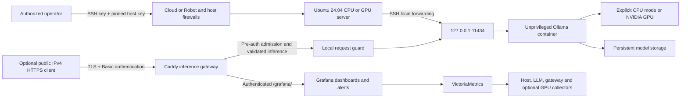

# LLM deployment and monitoring on Hetzner

Ansible configures an Ubuntu inference server and runs a local Ollama API in
Docker. NVIDIA GPU mode is the default; an explicitly selected CPU demo mode
supports an ordinary Hetzner Cloud VM. The dedicated-server Terraform directory
manages an existing GPU server's Robot network firewall.
GitHub Actions validates the code; a separate manual workflow can run Ansible
from a protected management runner. Optional Caddy HTTPS exposes inference at
the server's public IPv4 address with password authentication; no DNS is needed.
Optional VictoriaMetrics and Grafana provide host, inference, gateway, and GPU
monitoring through the same authenticated HTTPS endpoint.

**Validation boundary:** static checks cover the automation and gateway behavior.
The deployment playbook separately verifies real inference on the selected host.
CPU demo mode does not demonstrate NVIDIA driver installation or GPU inference;
the default GPU deployment retains those hardware acceptance checks.

The current demo is an Ubuntu 24.04 **ARM CAX21 CPU VM**, with Qwen3 4B Q4,
2048-token context, one inference at a time, and a 5 GB container memory limit.
It uses VictoriaMetrics, Grafana, and a public-IP certificate; no NVIDIA driver
is installed and GPU collection is disabled on this CPU machine. Cloud resources were created
through the configured provider API and configured with Ansible. Terraform code
is included and validated, but no Terraform plan/apply created this deployment.

**Deployment provenance (2026-10-28):** the initial demo and emergency Grafana
admission fix were deployed directly with Ansible over SSH. The remote ARM
runner `llm-cpu-demo-20261028` is now registered and online; it has a dedicated
account and a restricted loopback deployment key. The local Mac must not host
a runner. Successful **Deploy** runs record their deployed commit and run URL;
use those records to distinguish an Actions deployment from the initial manual
rollout. Validation runs alone are not deployment evidence.
The fixed live gateway passed a Chromium dashboard cold load and reload with
156 HTTP responses, 24 datasource queries, no HTTP errors, and no rate-limit
rejections. This checks dashboard loading, not every panel's metric semantics.
The additional idle-versus-unavailable latency display in this revision has
been tested against eight VictoriaMetrics fixtures, including missing telemetry.

All controller-side demo checkouts, environments, inventories, keys, client
configuration, and caches belong under **`/tmp`**, outside the home directory.
On macOS `/tmp` resolves to `/private/tmp`; protected-file checks use that
canonical path. Server service configuration and data use the standard paths
documented below. No credential value is committed to Git.

## Architecture and security boundary



- The API is **private by default**. Ollama has no built-in API authentication;
  the playbook refuses a public bind address. Use an SSH tunnel for encrypted,
  authenticated access. Optional public mode opens only TCP 80/443 for a Caddy
  gateway; port 11434 remains private in both modes.
- The container is non-root, has a read-only root filesystem, drops Linux
  capabilities, prohibits new privileges, and has memory/CPU/process/log limits.
- Model data persists in `/var/lib/ollama`; deployment files are root-managed in
  `/opt/ollama`. Cloud features are disabled with `OLLAMA_NO_CLOUD=1`.
- SSH password and keyboard-interactive authentication are disabled; existing
  SSH keys and host-key checking remain required. SSH forwarding stays enabled.
- Docker is root-equivalent administration. No user is added to its group.
  Docker Engine 28+ is required because older releases had a localhost-published
  port exposure issue on the same L2 network. UFW alone is not the security
  boundary for Docker-published ports.
- This assumes a dedicated, clean inference host. Existing unrelated UFW rules
  are retained; review and remove any pre-existing broad ingress rules before
  treating the host as SSH-only. Never reuse this configuration blindly on a
  multi-purpose production server.

## Prerequisites

**GPU target:** Ubuntu 24.04 LTS, x86_64, systemd, a physical/passed-through compatible
NVIDIA GPU, SSH key access, and root or passwordless sudo. Budget at least 16 GB
system RAM and 30 GB free disk for the example; a GPU with 8 GB+ VRAM is a
practical starting point for this small quantized model and 4096-token context.
Actual capacity depends on model, context, and concurrency. A Hetzner GEX45
(24 GB GPU VRAM) comfortably exceeds these example requirements.

For the explicitly selected CPU demo, Ubuntu 24.04 on x86_64 or aarch64 is
supported. A normal Hetzner Cloud VM with 4 vCPUs and 8 GB RAM, such as the ARM
CAX21, can run the same small model without NVIDIA hardware or drivers.
This exercises deployment and the API, but does not satisfy or validate the
original assignment's GPU requirement. CPU generation is slower; measure actual
latency before increasing context length or sharing the endpoint.

**Controller:** Python 3.12+, OpenSSH, and Terraform 1.15.x for the Terraform
directory. The target's Python is supplied by Ubuntu. Internet egress is needed
for Ubuntu, Docker, NVIDIA, Docker Hub, and the Ollama model registry.

Hetzner's GEX GPU machines are **dedicated Robot servers**, not GPU-capable
`hcloud_server` instances. Order/provision the machine, install Ubuntu, and
enroll your SSH key separately. This repository intentionally targets an
existing GEX server and does not automate a hardware purchase.

Verify the server's SSH host-key fingerprint through a trusted channel such as
the provider console before adding it to `known_hosts`. Do not disable host-key
verification or trust an unauthenticated `ssh-keyscan` result by itself.

## Configure and deploy with Ansible

Keep the checkout under `/tmp`. From its root, create a controller environment
and private inventory outside the checkout, also under `/tmp`:

```bash
DEMO_DIR="$(python3 -c 'import pathlib,tempfile; print(pathlib.Path(tempfile.mkdtemp(prefix="llm-demo-", dir="/tmp")).resolve())')"
export ANSIBLE_HOME="$DEMO_DIR/ansible"
export ANSIBLE_LOCAL_TEMP="$DEMO_DIR/ansible-tmp"
export XDG_CACHE_HOME="$DEMO_DIR/cache"
export TMPDIR="$DEMO_DIR"
python3 -m venv "$DEMO_DIR/venv"
. "$DEMO_DIR/venv/bin/activate"
python -m pip install -r requirements-dev.txt
cp inventory/example.yml "$DEMO_DIR/inventory.yml"
chmod 600 "$DEMO_DIR/inventory.yml"
```

Edit the private `$DEMO_DIR/inventory.yml`:

- Replace the documentation IP with your server address.
- Set the existing SSH account and port. Use `ssh-agent` or your local SSH
  configuration for the private-key reference; never put keys/passwords here.
- Replace `server_security_admin_cidrs` with your controller's public IPv4
  egress address or approved VPN range. The host role checks the current SSH
  source, when available, to reduce lockout risk. Robot must allow the same
  source; when using a jump host, this is the jump host's egress address.

Run syntax validation first. For a fresh driver install, explicitly allow the
maintenance reboot:

```bash
ansible-playbook -i "$DEMO_DIR/inventory.yml" playbooks/deploy.yml --syntax-check
ansible-playbook -i "$DEMO_DIR/inventory.yml" playbooks/deploy.yml \
  --extra-vars gpu_host_allow_reboot=true
```

Subsequent runs can omit the reboot opt-in when no driver update is needed:

```bash
ansible-playbook -i "$DEMO_DIR/inventory.yml" playbooks/deploy.yml
```

In its default NVIDIA mode, the playbook rejects CPU-only hosts, installs or verifies the NVIDIA driver,
installs Docker and NVIDIA Container Toolkit, configures the runtime, applies
host security, starts Ollama, installs the model, and verifies actual inference
with nonzero reported GPU residency. An existing working driver at or above
the configured baseline is preserved. A missing/old driver with Secure Boot
enabled fails safely; prepare properly signed modules/MOK enrollment through
your approved procedure rather than disabling Secure Boot automatically.

Model download can take several minutes. Repeated runs do not re-download an
installed model or recreate an unchanged service. A complete `--check` run on a
pristine GPU host cannot simulate package installation, reboots, or CUDA; use
the explicit syntax/lint checks and the post-deployment acceptance checks.

## Explicit CPU demo on Hetzner Cloud

Set these variables in the private inventory for a normal CPU VM; the existing
`gpu_servers` inventory group name is retained for compatibility:

```yaml
inference_accelerator: cpu
ollama_memory_limit: 5g
ollama_cpu_limit: "4"
ollama_context_length: 2048
ollama_parallel_requests: 1
```

These limits suit the 4-vCPU/8-GB CAX21 ARM demo. VictoriaMetrics has a 512 MiB
container limit; Grafana defaults to a 1 GiB hard limit with a 768 MiB Go runtime
memory target. Configure these together with `monitoring_grafana_memory` and
`monitoring_grafana_go_memory_limit`, keeping the runtime target below the hard
cap. The former 512 MiB Grafana cap caused confirmed OOM restarts and HTTP 502s
during dashboard loading. The 5 GiB Ollama cap, monitoring containers and guard
sum to about 6.75 GiB of limits; reserve the remaining host memory for the OS,
Caddy and the deployment runner, and measure peak usage during cold loads.
An 8-vCPU/16-GB x86 VM can use `ollama_cpu_limit: "8"` and
`ollama_memory_limit: 12g`. Keep the context and concurrency modest while
measuring latency; shared CPU availability changes throughput.

Omitting `inference_accelerator` still requires NVIDIA. CPU mode deliberately
skips GPU drivers/toolkit installation, removes GPU device reservations from
Compose, disables GPU visibility, and checks actual CPU inference with zero
reported VRAM residency. The same pinned `qwen3:4b-q4_K_M` model, authentication,
startup, health/recovery and firewall protections remain in use. The watchdog
does not run `nvidia-smi` in this mode. No GPU-host error silently switches the
deployment into CPU mode.

Run the same playbook without a driver reboot opt-in:

```bash
ansible-playbook -i "$DEMO_DIR/inventory.yml" playbooks/deploy.yml
```

For public testing, also configure the IP HTTPS options below. A Cloud server
uses the Hetzner Cloud firewall; dedicated GEX machines use Robot instead.

## Example API request

In one terminal, keep an SSH tunnel open (replace the example hostname):

```bash
ssh -N -o ExitOnForwardFailure=yes -o StrictHostKeyChecking=yes \
  -L 127.0.0.1:11434:127.0.0.1:11434 root@gpu.example.org
```

In another terminal:

```bash
curl --fail --silent --show-error http://127.0.0.1:11434/api/chat \
  --header 'Content-Type: application/json' \
  --data '{
    "model": "qwen3:4b-q4_K_M",
    "messages": [{"role": "user", "content": "Explain GPU inference in two sentences."}],
    "stream": false,
    "think": false,
    "options": {"num_ctx": 4096, "num_predict": 128}
  }'
```

The response contains `message.content` and `done`. This request carries no API
key because SSH already authenticates and encrypts the connection. Other local
users on the GPU host can also reach localhost: use a dedicated trusted host.

## Optional public HTTPS access without DNS

Set `public_api_enabled: true` and `public_api_address` to the server's public
IPv4 address in the private inventory. Enable the same flag in Terraform when
using its Robot firewall; public mode permits one SSH administrator CIDR to fit
Robot's ten-rule limit. No domain, DNS record, CDN or DNS API token is required.
Caddy 2.11.7 requests an IP certificate from Let's Encrypt using its `shortlived`
ACME profile and renews it automatically. TCP 80 and 443 must remain reachable
for certificate validation and renewal. This uses publicly trusted TLS with IP
address verification; do not disable certificate verification.

Create client credentials directly into a **new** protected directory outside
the repository. Replace the address below with the real globally routable
server address; the documentation address is intentionally rejected:

```bash
python scripts/create_api_credentials.py \
  --directory "$DEMO_DIR/client" --address 192.0.2.10
```

The helper generates a random password in process and writes only mode-0600
`client.curl` and `password.bcrypt` files inside a mode-0700 directory. It never
prints credential values, accepts passwords on its command line or overwrites
an existing directory. Set `public_api_password_hash_file` in the private
inventory to the absolute `$DEMO_DIR/client/password.bcrypt` path; the default username
is `llm`. The Ansible lookup checks ownership, parent permissions, symlinks and
the bcrypt format before use. Hash-bearing template tasks suppress logs/diffs.
The server stores only the hash, in a root-managed Caddy configuration.

After deployment, test without putting a password in shell history or process
arguments. `--disable` must be curl's first argument so a local `.curlrc` cannot
weaken TLS or redirect settings:

```bash
curl --disable --config "$DEMO_DIR/client/client.curl" \
  --header 'Content-Type: application/json' \
  --data '{"model":"qwen3:4b-q4_K_M","messages":[{"role":"user","content":"Say hello."}],"stream":false,"think":false,"options":{"num_predict":64}}'
```

Unauthenticated requests normally receive HTTP 401; repeated attempts receive
429 when their admission budget is exhausted. Authenticated inference clients may call
`GET /api/tags`, `GET /v1/models`, and `POST /api/chat`, `/api/generate`,
`/v1/chat/completions`, `/v1/completions`; model administration returns 404.
The gateway strips authorization/cookie headers before forwarding inference requests
to the local request guard. The guard applies the policy below and forwards only
validated requests to Ollama. There are no access, credential, or prompt logs.
When monitoring is enabled, `/grafana/` also permits the authenticated dashboard
application routes and preserves Grafana's cookies.

### Request admission and inference limits

The public gateway checks cheap admission rules **before bcrypt authentication**.
Source addresses come from the TCP peer; caller-supplied forwarding and guard
headers cannot choose an identity or bypass a bucket. Grafana browsing has its
own per-IP and global budgets, separate from API traffic and generation limits.
Caddy supplies the original request path to the guard; clients cannot select the
larger browsing allowance with a header.

Missing or malformed credentials receive a cheap **401** challenge, subject to
the applicable route budgets. They do not consume the small password-attempt
allowance, so browser authentication challenges do not prevent a subsequent
login. Plausibly formatted, previously unverified credentials share the strict
password-attempt budget across both Grafana and API routes before reaching
bcrypt. After Caddy validates a credential, the guard caches only its SHA-256
digest for 60 seconds to permit normal dashboard asset loading. Caddy still
authenticates every request. No plaintext credential is cached by the guard or
written to disk.

| Control | Default / live CPU demo |
|---|---|
| Plausible unverified credentials, per IP; shared across routes | 5/min sustained, burst 2 |
| Plausible unverified credentials, globally; shared across routes | 30/min sustained, burst 4 |
| API and other non-Grafana requests, per IP | 300/min sustained, burst 80 |
| API and other non-Grafana requests, globally | 600/min sustained, burst 120 |
| Grafana browsing, per IP | 1,800/min sustained, burst 300 |
| Grafana browsing, globally | 3,600/min sustained, burst 600 |
| Authenticated generation, per account and globally | 6/min sustained, burst 2 |
| Active public generation | 1; busy requests are rejected without queuing |
| Inference request body | 32 KiB |
| Combined text input | 8 KiB; at most 32 messages |
| Context allocation | Fixed at `ollama_context_length`: 2,048 tokens on the demo |
| Generated tokens | 256 maximum, including when the caller omits the limit |
| Generation deadline | 120 seconds, covering the upstream operation |

Rates use token buckets, so a short burst is allowed; these are not rolling-window
request counts. Throttled or busy requests return **429** with `Retry-After`.
IP state for plausible credentials is capped at 4,096 entries. Anonymous and
malformed requests use a separate map capped at 1,024 entries, evicting its oldest
entry when full. This eviction cannot reset password-attempt limits or displace
authenticated clients; route-global limits still apply. If configured with a
smaller IP capacity, the anonymous map also uses that smaller bound. Anonymous
and plausible-credential traffic have separate per-IP state within each route
budget, with shared route-global ceilings.
Invalid payloads return **400**, bodies exceeding the byte limit return **413**,
and unsupported content types or compression return **415**.
The text-byte limit is not a tokenizer-based prompt-token count. The fixed context
allocation bounds the model context; Ollama's normal prompt truncation still applies.

The guard accepts only the configured model and a text-only subset of native
Ollama and OpenAI-compatible requests. It rebuilds JSON from allowed fields;
duplicate keys, extra JSON values, unknown options, compressed bodies, images,
tools, templates, raw mode, caller-supplied context arrays and model-loading
overrides are rejected. Thinking is disabled for this bounded demo. Native
`num_ctx` cannot exceed the configured context and is normalized to that fixed
allocation; `num_predict`, OpenAI `max_tokens`, and the accepted
`max_completion_tokens` alias cannot exceed the output cap. Public OpenAI requests
cannot override context; deployment checks the backend environment, model
parameters, and effective context after an actual OpenAI inference.

Streaming remains supported. Slots are held through the response and released on
completion, disconnect, or deadline. The guard also bounds handler count, bucket
cardinality, response bytes and its own memory/CPU use. If it fails, Caddy rejects
requests; there is no direct inference fallback. Its listener and metrics remain
on loopback (`127.0.0.1:11435`).

A separate boot-enabled connection guard limits new TCP connection attempts to
ports 80/443: 40/second per address family (burst 80), 8/second per IP (burst 16), 32 simultaneous
connections per IP, and 256 per IP family overall. It manages only its own INPUT
chain; SSH, established traffic, ICMP and other firewall rules are unchanged.
Connection excess is dropped at the firewall, before TLS processing.
Changed admission policies and backend configurations pause public serving until
model/context acceptance succeeds. Failed checks leave admission stopped and
disabled; a corrected, successful deployment re-enables it.

These controls reduce application abuse and connection bursts on this single
server. They cannot absorb attacks that saturate its upstream link. Multiple users
sharing the demo password also share its account quota; use distinct identities
and an upstream filtering service for a wider public deployment.

For rotation, generate a new directory and update the inventory hash reference,
then rerun Ansible and replace the client's protected file. To close public
access, set the public flag false in both Ansible and Terraform and apply the
respective configurations; the raw model API stays on loopback throughout.
Protect/backup Caddy's `/var/lib/caddy` directory, which contains certificate
private keys and ACME account data. Monitor certificate expiry and renewal
failures; IP certificates are valid for only about six days.

## VictoriaMetrics and Grafana

Set `monitoring_enabled: true` alongside `public_api_enabled: true` in the
private inventory, then run the same playbook. Open
`https://SERVER_IPV4/grafana/` and use the existing HTTPS username/password from
the protected client configuration. Caddy authenticates the request and supplies
a fixed identity to Grafana. Grafana trusts only the loopback proxy; anonymous,
basic, and form login and default-admin creation are disabled. No second public
port or DNS name is needed.

VictoriaMetrics is the storage and query engine. Its built-in scraper collects
Prometheus-format metrics every 30 seconds; there is no Prometheus server.
Grafana uses the Prometheus-compatible datasource protocol to query it.

| Component | Listener | Purpose |
|---|---|---|
| VictoriaMetrics | `127.0.0.1:8428` | Scraping, storage, PromQL/MetricsQL queries |
| Grafana | `127.0.0.1:3000` | Dashboards and alert evaluation behind `/grafana/` |
| Node exporter | `127.0.0.1:9100` | Host CPU, memory, disk and network |
| LLM exporter | `127.0.0.1:9400` | Cached model health and bounded inference probes |
| Caddy metrics | `127.0.0.1:2019` | Gateway counters and latency; admin API remains off |
| Admission guard | `127.0.0.1:11435` | Private policy checks, inference proxy and rejection metrics |

Five provisioned dashboards cover **Host**, **Inference**, **GPU**, **Gateway**,
and **Alerts**. Guard metrics show real admission attempts, throttling, rejected
payloads and inference occupancy. Caddy charts select the observed top-level
`subroute` handler: completed public gateway requests and server handling time,
including authentication, admission and streaming. They combine API and Grafana
traffic and do not measure client end-to-end latency. GPU panels show CPU mode/no GPU data
on the demo instead of fabricating zero-valued GPU measurements.

Nineteen Grafana-managed rules cover scrape failures, CPU/memory/disk pressure,
LLM availability and probe failures/freshness/latency, and GPU collection,
temperature and VRAM pressure. Rule definitions live in
`roles/monitoring/files/grafana-alerts.yml`. The Alerts dashboard shows actual
Grafana firing/pending states. Notifications are deliberately muted by the
provisioned local-only policy; SMTP is disabled and no external destination is
configured. Add an approved contact point and change that policy before relying
on notification delivery.

The LLM collector polls `/api/tags` and `/api/ps` every 30 seconds and performs
an eight-token synthetic inference every five minutes. It uses the configured
context length, keeps the model warm for five minutes, and may consume a small
amount of inference capacity. Scraping does not trigger generation. Latency,
token rate, counters and failures from this collector describe **synthetic
probes**, not all user requests. Prompts and responses are never logged or used
as labels. Each probe has a hard deadline, and probes of the same type cannot
overlap.

On NVIDIA hosts, a timer writes utilization, VRAM, temperature, power and
collection-health metrics from `nvidia-smi` into node exporter's textfile
directory. On CPU hosts the timer is disabled and stale GPU metrics are removed.
This is not DCGM-level ECC/Xid or multi-GPU interconnect instrumentation.

Metrics and Grafana state persist under `/var/lib/llm-monitoring`; configuration
is under `/etc/llm-monitoring`. VictoriaMetrics retains three days of data;
retention cleanup is asynchronous and is not a hard disk-size cap. Containers
run without root or the Docker socket. Grafana's signing key is generated on the
server, stored with owner-only permissions, and never returned to Ansible.

```bash
sudo systemctl status monitoring.service llm-exporter.service
sudo docker compose --project-name llm-monitoring \
  --file /etc/llm-monitoring/compose.yml ps
curl --fail --silent http://127.0.0.1:8428/health
```

This monitoring stack shares the inference host. It cannot notify about a total
host/Grafana outage when its own evaluator is unavailable; production monitoring
needs an independent observer and notification delivery.

## Startup, health, and recovery

`ollama.service` owns the Compose lifecycle and starts at boot. Docker's
`unless-stopped` policy handles process exits. The container healthcheck runs
`ollama list`; `/api/tags` establishes API/model availability.

Docker does not restart a container simply because it is unhealthy. The
`ollama-watchdog.timer` therefore checks the container, the model catalogue,
and, in NVIDIA mode, container-side `nvidia-smi` every 60 seconds. Recovery requires repeated
failure, has a five-minute cooldown, and is capped at three attempts per hour.
A shared lock prevents a recovery from interrupting model downloads or service
maintenance. A missing model raises a fixed journal event instead of causing
an endless restart loop. An explicit administrative service stop is respected.

The deployment acceptance check also generates real tokens and checks
`/api/ps` for `size_vram > 0`. This proves GPU participation, not that every layer
is offloaded. On failed acceptance, the service is disabled/stopped instead of
leaving unintended CPU-only inference enabled. Explicit CPU demo mode instead
requires successful generation with zero reported VRAM residency. The periodic watchdog is a liveness/device
check; it does not continuously generate tokens or prove inference quality.

Useful commands on the GPU host:

```bash
sudo systemctl status ollama.service ollama-watchdog.timer
sudo journalctl -u ollama.service -u ollama-watchdog.service --since '30 minutes ago'
sudo docker compose --project-name gpu-llm --file /opt/ollama/compose.yml ps
nvidia-smi
curl --fail --silent http://127.0.0.1:11434/api/tags
sudo systemctl stop ollama.service
```

Do not enable verbose request/prompt logging in a shared log sink. The watchdog
emits only fixed event names, not model responses or container logs.

## Terraform: Cloud and dedicated-server configurations

[`terraform/cloud`](terraform/cloud/README.md) describes the CPU demo's CAX21,
IPv4, SSH key and stateful firewall. It also includes the public SSH fingerprint
console banner used to verify the host without disabling host-key checking.
Import existing API-created resources before adopting them into Terraform;
applying a fresh state would create additional resources.

See [terraform/README.md](terraform/README.md) for variables, provider scope,
authentication boundaries, and rules. The configuration:

1. Looks up an existing GEX by Robot server number.
2. Enables the Robot firewall with IPv4 SSH access from one to three admin CIDRs.
3. Allows essential replies to outbound traffic, with IPv6 filtering enabled.
4. Exports a static Ansible inventory as YAML.

No Terraform plan or apply is part of validation or any workflow. The pinned
`futo-org/hetzner` provider is community-maintained; its source and lockfile are
included for review. The firewall has `prevent_destroy` because provider
deletion would disable its protection.

Only after a separately authorized infrastructure run has populated state can
the generated inventory be exported:

```bash
umask 077
terraform -chdir=terraform output -raw ansible_inventory_yaml > "$DEMO_DIR/inventory.yml"
```

Alternatively use the manual Ansible inventory without Terraform. Local
inventories, real tfvars, state, plans, credential files, and model data are
excluded from Git. `.terraform.lock.hcl` is deliberately committed.

## Credentials and the existing Keychain API

This repository contains no credentials and needs none for static validation.
The inspected `hetzner-api` Keychain profile targets the **Hetzner Cloud API**;
it cannot authenticate the **Robot API** used by dedicated GEX servers. Its
Cloud token must not be reused as a Robot password or sent to a different API.

An authenticated Robot Terraform run requires an approved secret-store integration to inject
`HETZNER_ROBOT_USERNAME` and `HETZNER_ROBOT_PASSWORD` into the provider process.
The checked-in provider block intentionally contains no credentials. Do not
paste credentials into commands/chat, commit them in tfvars, export Terraform
debug logs, or modify the Keychain routing policy as a shortcut. Cloud provider
authentication is separate. The deployed Cloud demo used the approved API
transport; provider credentials were not extracted into Terraform or the repo.

Ansible uses the controller's SSH agent and verified `known_hosts`; private keys
stay outside the repository under the private `/tmp` demo directory. Use protected, encrypted remote Terraform state
with locking for team operation, and restrict state access even though the
current resources do not intentionally store passwords in state.

## GitHub Actions

- **Validate:** GitHub-hosted Ubuntu runner; Ansible syntax and production lint,
  Python recovery/security tests, rendered Compose schema check, Terraform
  formatting and validation, actual Caddy direct-IP TLS/authentication tests,
  and checksum-pinned Gitleaks scans. It has read-only
  repository permissions and no infrastructure credentials. No plan/apply.
- **Deploy:** manual `workflow_dispatch` on `main` only, never a PR trigger. It
  targets the requested remote ARM runner with the labels
  `self-hosted`, `linux`, `ARM64`, and `llm-deploy`, and the
  `gpu-production` environment. Configure environment approval where available,
  branch protection, and restrict workflow dispatch to trusted maintainers.
  For this explicitly requested demo, the repository-scoped runner shares the
  existing Hetzner CPU inference server. It runs as the non-root `llm-runner`
  account with no sudo grant. Deployment uses a dedicated root SSH key restricted
  to `127.0.0.1`, with a pinned host key and no PTY or forwarding. This still
  grants trusted workflow code root command execution on this host.
  PR validation stays on GitHub-hosted runners; never
  send untrusted PR jobs to the deployment runner. No runner runs on the local
  Mac as part of this configuration.
  Put the runner-owned, non-executable mode-0600 static YAML inventory at
  `/tmp/llm-actions-runner/protected/inventory.yml`, outside the checkout, and
  set that path as the GitHub environment **variable** `LLM_INVENTORY_FILE`.
  The inventory uses loopback SSH and references the protected deployment key
  and pinned `known_hosts`; private-key contents are never interpolated into
  workflow scripts. The runner needs Python 3.12+ and an up-to-date GitHub
  Actions runner (2.329.0+ for the pinned Node.js 24 actions).
  Checkout does not update Git's global safe-directory configuration. Pip
  caching is disabled, and controller caches and temporary files stay under
  `RUNNER_TEMP`. After Ansible succeeds, the job records only the deployed
  commit SHA and workflow-run URL in its output and run summary.

The manual workflow performs Ansible deployment when deliberately invoked; it
does not provision or purchase servers. Private-repository Actions minutes may
be billable according to the account's GitHub plan.

The remote runner must be bootstrapped and registered before dispatch. Its home,
installation, working directories, registration credentials and protected
inventory belong under `/tmp/llm-actions-runner` on the server. A systemd unit
in the standard service directory manages the long-running runner process;
clearing `/tmp` removes its operational state and requires reprovisioning and
registration as needed. The runner is not installed on the local Mac.

The existing demo was initially deployed manually with Ansible. Checking in the
workflow or registering its runner does not itself redeploy the server; a
successful Actions run provides the revision evidence described above.

### Bootstrap the remote deployment runner

Run bootstrap from the existing protected controller environment and inventory.
It prepares the account, pinned runner release, restricted loopback SSH key and
disabled systemd service; it does not register or start the runner. Only the
existing bcrypt hash is copied, never the public API's plaintext password.

```bash
ansible-playbook -i "$DEMO_DIR/inventory.yml" playbooks/bootstrap-runner.yml \
  --extra-vars "actions_runner_bcrypt_source_file=$DEMO_DIR/client/password.bcrypt"
mkdir -m 700 "$DEMO_DIR/runner-registration"
python scripts/create_runner_registration_token.py \
  --repository thuban-arrakis/hetzner-gpu-llm-ansible \
  --output "$DEMO_DIR/runner-registration/registration-token.json"
```

The token helper uses the controller's existing authenticated GitHub CLI and
writes a new mode-0600 file inside the mode-0700 directory without displaying
the token. Never paste a registration token into a command or chat.

Create a protected copy of the existing inventory as
`$DEMO_DIR/runner-inventory.yml`. Preserve the CPU/model/resource/monitoring/public
API settings and existing external administrator CIDRs. Add `127.0.0.1/32` to
`server_security_admin_cidrs` so the SSH-source preflight accepts the runner's
loopback connection. Change only the connection and hash-file references on its
existing host to:

```yaml
ansible_host: 127.0.0.1
ansible_user: root
ansible_connection: ssh
ansible_ssh_use_tty: false
ansible_ssh_private_key_file: /tmp/llm-actions-runner/protected/deploy_ed25519
ansible_ssh_common_args: >-
  -o StrictHostKeyChecking=yes
  -o UserKnownHostsFile=/tmp/llm-actions-runner/protected/known_hosts
  -o IdentitiesOnly=yes -o RequestTTY=no
public_api_password_hash_file: /tmp/llm-actions-runner/protected/password.bcrypt
```

Keep that inventory mode 0600. Using your existing verified SSH configuration,
replace the documentation address below, transfer the two protected files and
set their remote ownership before registration:

```bash
RUNNER_HOST=root@192.0.2.10
scp -p -o StrictHostKeyChecking=yes \
  "$DEMO_DIR/runner-registration/registration-token.json" \
  "$RUNNER_HOST:/tmp/llm-actions-runner/protected/registration-token.json"
scp -p -o StrictHostKeyChecking=yes "$DEMO_DIR/runner-inventory.yml" \
  "$RUNNER_HOST:/tmp/llm-actions-runner/protected/inventory.yml"
ssh -T -o StrictHostKeyChecking=yes "$RUNNER_HOST" \
  'chown llm-runner:llm-runner /tmp/llm-actions-runner/protected/{registration-token.json,inventory.yml} && chmod 600 /tmp/llm-actions-runner/protected/{registration-token.json,inventory.yml}'
ssh -T -o StrictHostKeyChecking=yes "$RUNNER_HOST" \
  'runuser -u llm-runner -- python3 /tmp/llm-actions-runner/configure_actions_runner.py --repository thuban-arrakis/hetzner-gpu-llm-ansible --name llm-cpu-demo-20261028'
```

The registration helper passes the token only through the runner subprocess's
environment, suppresses subprocess output, and removes the remote token file on
success. Remove the controller's temporary token file after successful
registration. The runner's persistent registration credentials stay protected
under its own directory.

The `gpu-production` environment variable `LLM_INVENTORY_FILE` is configured as
`/tmp/llm-actions-runner/protected/inventory.yml`. After registration and inventory
checks succeed, start the remote service, then manually dispatch **Deploy to an
existing LLM server** on `main` in GitHub Actions:

```bash
ssh -T -o StrictHostKeyChecking=yes "$RUNNER_HOST" \
  'systemctl enable --now llm-actions-runner.service'
```

These instructions do not imply that registration or an Actions deployment has
already completed; check the job result and its recorded commit SHA/run URL.

## Local validation

```bash
. "$DEMO_DIR/venv/bin/activate"
ansible-playbook -i inventory/example.yml playbooks/deploy.yml --syntax-check
ansible-playbook -i inventory/example.yml playbooks/bootstrap-runner.yml --syntax-check
ansible-lint
TMPDIR="$DEMO_DIR" python -m pytest -q --basetemp="$DEMO_DIR/pytest"
GOCACHE="$DEMO_DIR/go-cache" GOPATH="$DEMO_DIR/go" GOTOOLCHAIN=local \
  GOPROXY=off GOSUMDB=off go -C roles/public_api/files/api_guard test -race ./...
terraform -chdir=terraform fmt -check -recursive
terraform -chdir=terraform init -backend=false -input=false -lockfile=readonly
terraform -chdir=terraform validate
terraform -chdir=terraform/cloud init -backend=false -input=false -lockfile=readonly
terraform -chdir=terraform/cloud validate
```

The Compose schema test needs the Docker Compose v2 CLI, not a running GPU or
Docker daemon. It skips when the local plugin is unavailable; CI explicitly
requires the plugin. Python tests exercise restart budgets/cooldowns, transient
failure behavior, missing-model handling, and protected deployment inventory
validation. They are not a substitute for a real GPU deployment or an
idempotence run on a representative host.

The gateway tests need Caddy 2.11.7 available as `caddy` or via the
`CADDY_BINARY` environment variable. CI downloads and verifies that binary.
They exercise no-SNI IP TLS with an ephemeral, locally trusted test certificate,
authentication and denial of administrative routes. A real Caddy-plus-Go test
also covers 200 authenticated dashboard asset requests, query preservation,
anonymous challenges, invalid-password throttling, forged header rejection,
payload limits and inference concurrency. These local protocol checks do not
constitute full browser verification; they do not request a live
Let's Encrypt certificate or contact any public model endpoint.
Monitoring tests cover Compose isolation, GPU textfile failure handling,
protected Grafana key files, and LLM probe timeouts/overlap/metrics behavior.

## Configuration and improvements

Role defaults are documented in `roles/*/defaults/main.yml`. The example pins
Ollama 0.40.12 by OCI digest, NVIDIA Container Toolkit 1.20.1-1, and
`qwen3:4b-q4_K_M` by model manifest digest. Change the model name and approved
digest together after reviewing a new artifact. A digest mismatch fails
deployment. Never set a mutable `latest` image for unattended inference.

For a larger deployment:

- Extend GPU telemetry with NVIDIA DCGM Exporter for ECC/Xid and multi-GPU
  diagnostics, and move VictoriaMetrics/alert evaluation to an independent host.
  Configure notification delivery and monitor certificate expiry externally.
- Extend the authenticated TLS gateway for application clients with mTLS or
  OIDC and distinct client identities with separate budgets. Tune the admission
  and inference limits using observed latency. Keep model pull/delete administration
  private. Do not simply publish Ollama's raw port.
- Use vLLM when continuous batching and multi-GPU throughput justify its greater
  model/runtime complexity. Benchmark time-to-first-token and tokens/second on
  representative prompts before changing serving engines.
- Use multiple GPU nodes with readiness-aware routing and queue backpressure.
  One server is not HA. Preserve model artifacts/digests and deployment
  configuration so failed hardware can be replaced reproducibly.
- Centralize secret management, enforce signed/reviewed configuration changes,
  and use a protected state backend. Keep prompts out of default logs.

## Primary references

- [Hetzner GPU server documentation](https://docs.hetzner.com/robot/dedicated-server/server-lines/gpu-server/)
- [Ubuntu NVIDIA driver installation](https://documentation.ubuntu.com/server/how-to/graphics/install-nvidia-drivers/)
- [Docker Engine on Ubuntu](https://docs.docker.com/engine/install/ubuntu/)
- [Docker port publishing security](https://docs.docker.com/engine/network/port-publishing/)
- [NVIDIA Container Toolkit installation](https://docs.nvidia.com/datacenter/cloud-native/container-toolkit/latest/install-guide.html)
- [Ollama Docker deployment](https://docs.ollama.com/docker)
- [Ollama API](https://docs.ollama.com/api)
- [Ollama model catalogue](https://registry.ollama.com/library/qwen3/tags)
- [Pinned Robot provider](https://github.com/futo-org/terraform-provider-hetzner/tree/v1.1.0)
- [Caddy TLS issuer and ACME profile configuration](https://caddyserver.com/docs/caddyfile/directives/tls)
- [Let's Encrypt IP certificates and short-lived certificate availability](https://letsencrypt.org/2026/01/15/6day-and-ip-general-availability/)
- [VictoriaMetrics single-server operation](https://docs.victoriametrics.com/victoriametrics/single-server-victoriametrics/)
- [Grafana auth proxy](https://grafana.com/docs/grafana/latest/setup-grafana/configure-access/configure-authentication/auth-proxy/)
- [Grafana alerting file provisioning](https://grafana.com/docs/grafana/latest/alerting/set-up/provision-alerting-resources/file-provisioning/)
